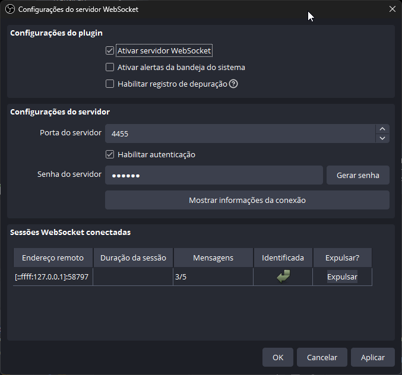
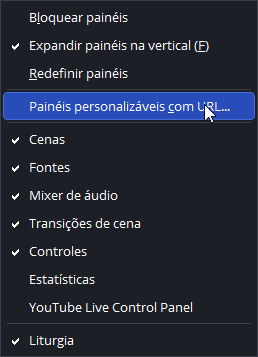
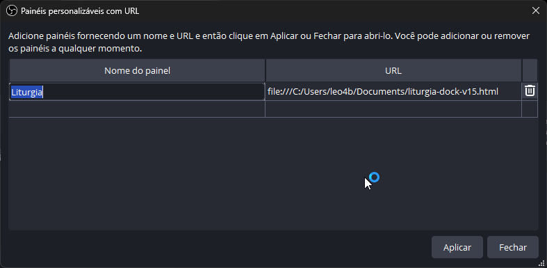
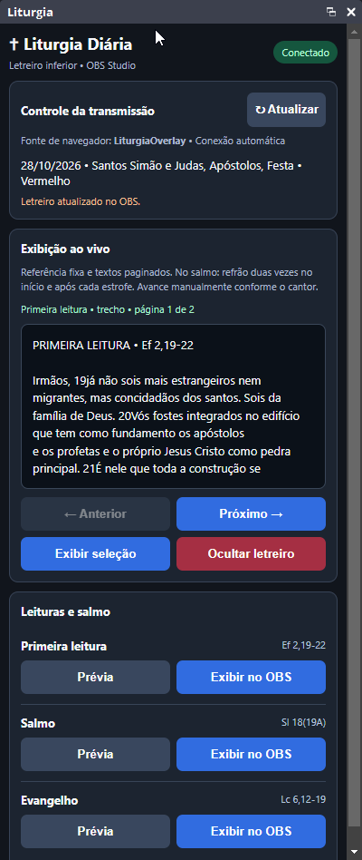

# LiturgyDock

Painel de liturgia diária para o OBS Studio. Ele baixa as leituras do dia, pagina o texto e publica o trecho escolhido no letreiro da transmissão.

O arquivo do painel é `liturgia-dock-v15.html`.

## Fonte da liturgia

O painel usa a liturgia do dia desta API:

```text
https://liturgia.up.railway.app/v2/
```

Cada leitura chega como lista, então o painel mostra primeira leitura, salmo, segunda leitura, leituras extras e evangelho quando a data tiver mais de uma opção (por exemplo, forma longa e forma breve, ou a Vigília Pascal).

## Configurar o OBS Studio

O OBS Studio 28 ou superior já traz o servidor WebSocket. O painel fala com ele em `ws://127.0.0.1:4455`.

### 1. Servidor WebSocket

Abra **Ferramentas → Configurações do servidor WebSocket** e deixe assim:

- **Ativar servidor WebSocket** marcado
- **Porta do servidor:** `4455`
- **Habilitar autenticação** marcado
- **Senha do servidor:** `123456`

A senha é o valor de `PASSWORD` em `liturgia-dock-v15.html`. Se mudar a senha no OBS, altere a mesma constante no arquivo.



### 2. Cena do letreiro

Crie uma cena chamada `LITURGIA`. Na primeira vez que um texto for exibido, o painel cria nessa cena a fonte de navegador `LiturgiaOverlay`, em 1920×1080.

Se já existir uma fonte com esse nome e ela não for uma fonte de navegador, renomeie ou apague a fonte antiga antes de exibir.

### 3. Painel no OBS

No menu **Painéis**, escolha **Painéis personalizáveis com URL...**.



Adicione uma linha com o nome **Liturgia** e a URL do arquivo local. No OBS o endereço precisa do prefixo `file:///`:

```text
file:///C:/Users/leo4b/Documents/github/LiturgyDock/liturgia-dock-v15.html
```

Clique em **Aplicar**. O painel **Liturgia** passa a aparecer no menu de painéis.



A captura acima usa uma cópia em `Documentos`. Aponte a URL para o `liturgia-dock-v15.html` que você está editando.

### 4. Transmitir uma leitura

Com o OBS aberto e o WebSocket ativo, o painel conecta sozinho. O status no canto superior fica **Conectado**.



- **Atualizar** busca de novo a liturgia do dia.
- **Prévia** mostra o texto no painel, sem enviar ao OBS.
- **Exibir no OBS** e **Exibir seleção** publicam a página atual no letreiro.
- **Anterior** e **Próximo** trocam a página. Se o letreiro já estiver no ar, a página nova também é enviada.
- **Ocultar letreiro** limpa o texto da fonte.

No salmo, o refrão entra duas vezes no início e de novo depois de cada estrofe. Avance as páginas no ritmo do cantor.
